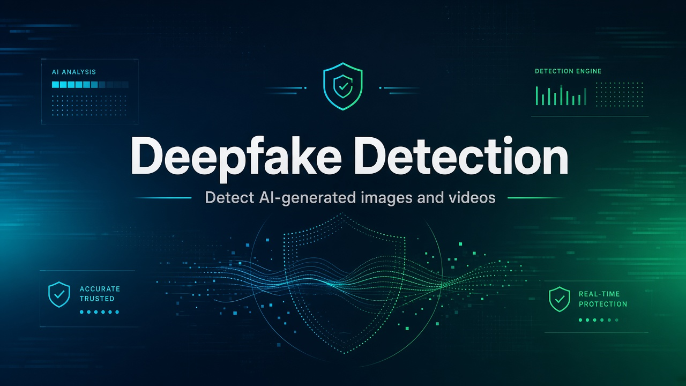
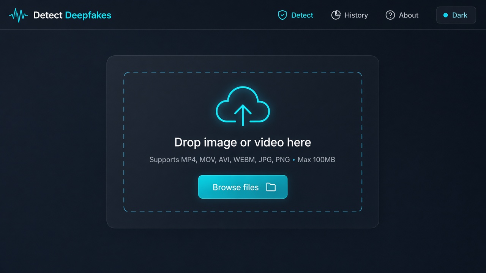
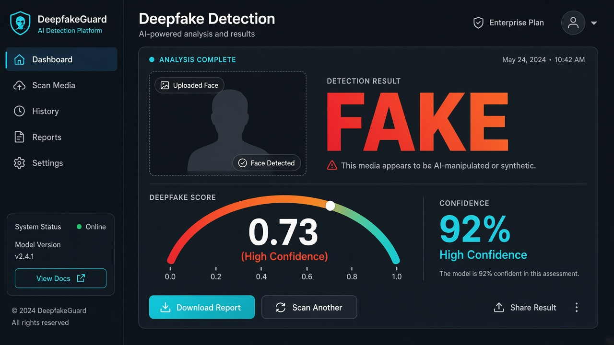

# Deepfake Detection Website

<p align="center">
  
</p>

End-to-end deepfake detection web app for **images and videos**. Upload media, run inference through a PyTorch model, and view REAL / FAKE results in a React UI.

Built to run **locally** (no Docker required).

<p align="center">
  <a href="https://github.com/sarthakpatel2/DeepfakeDetection">
    
  </a>
  
  
  
</p>

## Preview

| Upload | Results |
|:------:|:-------:|
|  |  |

## Features

- Image and video upload with job tracking
- FastAPI backend with background processing for videos
- PyTorch CNN detector scaffold (trainable)
- MongoDB persistence for jobs and results
- React + TypeScript + Tailwind frontend
- Landing, upload, results, and about pages

## Tech Stack

| Layer | Tech |
|-------|------|
| Backend / ML | Python 3.10+, FastAPI, PyTorch, OpenCV |
| Database | MongoDB (Motor) |
| Background jobs | FastAPI `BackgroundTasks` (default) · Celery + Redis (optional) |
| Frontend | React (Vite), TypeScript, Tailwind CSS |
| Testing | pytest · Vitest |

## Prerequisites

- Python **3.10+**
- Node.js **18+**
- MongoDB running locally (`mongodb://localhost:27017`)
- Redis *(optional — only if using Celery)*

## Quick Start

### 1. Clone the repo

```bash
git clone https://github.com/sarthakpatel2/DeepfakeDetection.git
cd DeepfakeDetection
```

### 2. Backend

```bash
cd backend
python -m venv .venv

# Windows PowerShell
.\.venv\Scripts\Activate.ps1

# macOS / Linux
# source .venv/bin/activate

pip install -r requirements.txt
uvicorn app.main:app --reload --host 127.0.0.1 --port 8000
```

API: **http://127.0.0.1:8000** (health check returns `{"status":"ok"}`)

### 3. Frontend

Open a second terminal:

```bash
cd frontend
npm install
npx vite --host 127.0.0.1 --port 5173
```

App: **http://127.0.0.1:5173**

> Tip: keep MongoDB running before starting the backend.

## API Endpoints

| Method | Endpoint | Description |
|--------|----------|-------------|
| `POST` | `/upload` | Upload image/video → returns `{ job_id }` |
| `GET` | `/jobs/{id}` | Job status and metadata |
| `GET` | `/results/{id}` | Aggregated inference results |
| `POST` | `/inference/predict` | Synchronous image prediction |

## Project Structure

```text
DeepfakeDetection/
├── backend/
│   ├── app/                 # FastAPI app, APIs, inference, models
│   ├── train/               # Training & evaluation scripts
│   ├── scripts/             # Utility / diagnostic scripts
│   └── requirements.txt
├── frontend/
│   └── src/                 # React pages & components
├── docs/images/             # README screenshots & banners
├── data/                    # Training data, uploads, model checkpoints
├── SETUP_AND_USAGE_GUIDE.md # Detailed setup & training guide
└── README.md
```

## Training the Model

The detector is a scaffold CNN — train it before expecting strong accuracy.

```bash
cd backend
python train/quick_start.py   # creates data/train/real and data/train/fake
# add images to those folders, then:
python train/train.py
python train/eval.py
```

Default checkpoint path: `data/detector.pt`

See `backend/TRAINING_GUIDE.md` and `SETUP_AND_USAGE_GUIDE.md` for full details.

## Team

| Member | Role |
|--------|------|
| **Sarthak (Group Lead)** | Architecture & Coordination |
| Aman | API & Infrastructure |
| Madhav | Backend & Model Integration |
| Pragati | Research & Coordination |
| Racheet | Backend & Model Integration |
| Shivendra | Frontend & UX |

## Notes

- This project is intended for **education / demo** use.
- Model quality depends heavily on training data size and quality.
- Do not upload sensitive personal media to demo setups.
- See `PRIVACY.md` and `DISCLAIMER.md`.

## License

MIT — see [LICENSE](LICENSE).
